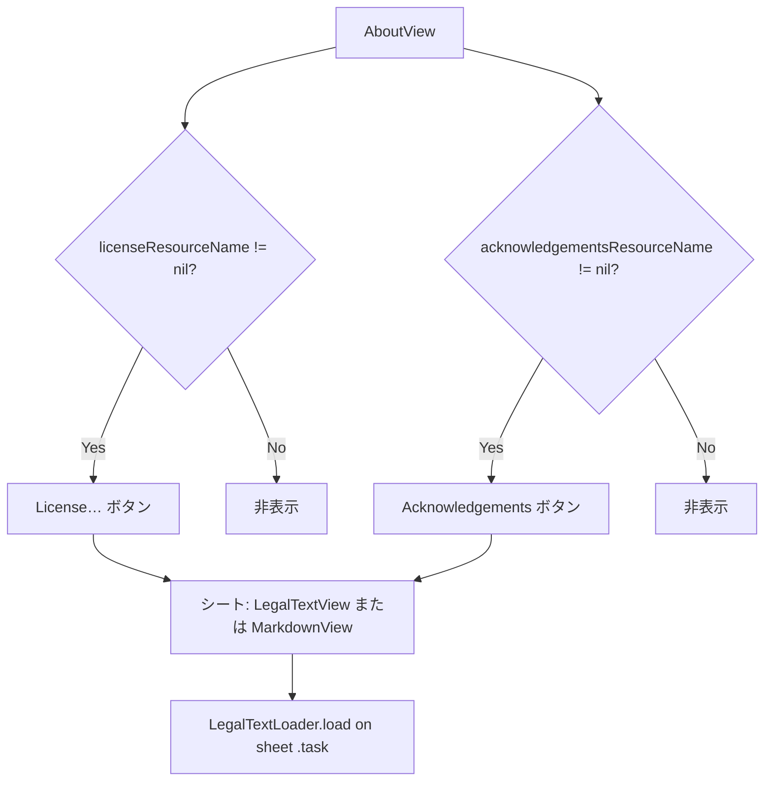

# S2J About Window - バンドル同梱リーガルテキスト表示

Issue: [#17](https://github.com/stein2nd/s2j-about-window/issues/17) (**完了** — 2.0.13〜3.0.1で実装・受け入れ済み)

ホストアプリケーションの About から、バンドル同梱の License / Acknowledgements 長文をオフライン表示する機能の仕様です。  
設計上の決定経緯は [docs_mod/status.md](../docs_mod/status.md) を参照してください。

## 1. 目的とスコープ

### 1.1. 目的

ホストアプリケーションの About から、**アプリケーションバンドルに同梱した長文テキスト** (アプリケーション自身の License、サードパーティ Acknowledgements) を、**オフラインで全文参照** できるようにします。

* About 本文 (`MarkdownView`) は、短い説明・リンク集向けとし、GPL 全文などの長文は **別画面** で表示する。
* License (本アプリケーションの利用条件) と Acknowledgements (サードパーティ・クレジット) は **UI 上も、データ上も、分離** する。

### 1.2. 非目標

* GitHub 上の `LICENSE` URL を開く機能の削除 (利用側 Markdown に残してもよい。ライブラリは、バンドル表示を **追加** する)。
* SPM / npm 依存の自動収集と、Acknowledgements の自動生成。
* RTF / PDF / HTML のネイティブレンダリング (将来 Backlog)。
* `MarkdownView` の Markdown ブロック分割ロジックの、長文最適化 (本機能の責務外)。

### 1.3. 用語

| 語彙 (仕様) | 意味 | 典型リソース |
| --- | --- | --- |
| **License** | 本アプリケーションに適用される、利用条件の全文 | `LICENSE`、`LICENSE.txt` |
| **Acknowledgements** | 組み込みサードパーティ成果物のクレジット | `ACKNOWLEDGEMENTS.md`、`ACKNOWLEDGEMENTS.txt` |
| **バンドル同梱リーガルテキスト** | 上記いずれかを指す総称 (実装上の Document 種別で区別) |

UI 語彙は [UX_VOCABULARY.md](https://github.com/stein2nd/xcode-common-specs/blob/main/docs/UX_VOCABULARY.md) に合わせ、画面見出しでは SwiftUI の型名を使いません。

## 2. 要件

凡例: **Must** / **Should** / **Could** ([SPEC.md](./SPEC.md) と同じ)

### 2.1. 機能要件

| ID | レベル | 内容 |
| --- | --- | --- |
| LEG-01 | **Must** | ホスト `Bundle` 内の License リソースを読み込み、About からアプリケーション内のみで全文表示できる。 |
| LEG-02 | **Should** | `acknowledgementsResourceName` (または同等) が指定されたとき、同パターンで第二文書を表示できる。未指定なら Acknowledgements 用 UI は **非表示**。 |
| LEG-03 | **Must** | 表示は縦スクロール可能とし、テキスト選択を有効にする ([UI_VIEWPORT.md](https://github.com/stein2nd/xcode-common-specs/blob/main/docs/UI_VIEWPORT.md) の Content Integrity)。 |
| LEG-04 | **Must** | `AboutView` / `aboutSheet` / `aboutPopover` / macOS `AboutWindow.showAboutWindow` で、**同じオプション引数** により License / Acknowledgements を有効化できる。 |
| LEG-05 | **Should** | License 用ボタンラベルは macOS 慣習の **「License…」** (省略記号付き)。Acknowledgements は **「Acknowledgements」** (シートタイトルと揃える)。 |
| LEG-06 | **Should** | Acknowledgements のリソースが `.md` のとき、シート内で `MarkdownView` を使う (§6)。 |

### 2.2. 非機能要件

| ID | レベル | 内容 |
| --- | --- | --- |
| LEG-NF-01 | **Must** | リソースのロード失敗を UI で握りつぶさない (空状態またはインラインエラー)。 |
| LEG-NF-02 | **Should** | 10KB 超の License でも About 本体の初回表示をブロックしない (遅延ロード: ボタン押下またはシート表示時)。 |
| LEG-NF-03 | **Must** | ダークモードで読める (システム `body` / 等幅、背景は About と同系の `windowBackground` / `systemBackground`)。 |

## 3. 設計方針 (COMMON_SPEC との整合)

* **責務分離**: ファイル I/O はアダプタ (`LegalTextLoader`)。プレーン長文は `LegalTextView`、Acknowledgements `.md` は `MarkdownView`。About へのボタン配置は `AboutView`。
* **MVVM**: 既存の [architecture.md](./architecture.md) に従い、`AboutViewModel` はメタデータと About 本文のみ。シートの `isPresented` とロード結果は `AboutView` の `@State` で持つ (ViewModel を肥大化しない)。
* **1ファイル1型**: `LegalTextView.swift`、`LegalTextLoader.swift` (短い場合は loader を View ファイルに `internal` 同居可。公開は View / Loader / 型のみ)。
* **プラットフォーム**: macOS / iOS とも長文は **`.sheet`** ([UX_VOCABULARY](https://github.com/stein2nd/xcode-common-specs/blob/main/docs/UX_VOCABULARY.md))。macOS `AboutWindow` (`NSHostingController`) 上も同じ。`minWidth` / `minHeight` で macOS のシートを広めにする。**補助 `NSWindow` は Backlog** ([SPEC.md](./SPEC.md) §11)。

## 4. 公開 API

### 4.1. 型

```swift
/// License と Acknowledgements を区別する (ローカライズキー・デフォルトタイトル・表示分岐に使用)。
public enum LegalTextKind: String, Sendable {
    case license
    case acknowledgements
}

/// バンドルからのロード結果 (ドメイン。UI はこれに応じて本文 / 空 / エラーを出す)。
public enum LegalTextContent: Equatable, Sendable {
    case plainText(String)
    case empty
    case loadFailed
}
```

```swift
/// プレーン長文のスクロール表示 (License および非 Markdown の Acknowledgements)。
@available(macOS 15.0, iOS 18.0, *)
public struct LegalTextView: View {
    public init(content: LegalTextContent)
}
```

公開型名: `LegalTextView` / `LegalTextContent` / `LegalTextKind` / `LegalTextLoader` / `LegalTextLoadResult`。  
シートのタイトルは `LegalTextDocumentSheet` (internal) が `navigationTitle` で付与。Acknowledgements の `.md` 表示分岐には `LegalTextLoader.usesMarkdownRendering(kind:result:)` を使用。

### 4.2. 読み込み (アダプタ)

```swift
public enum LegalTextLoader {
    /// - Parameters:
    ///   - bundle: 通常はホストアプリケーションの `Bundle.main`
    ///   - resourceName: 拡張子を含まない場合あり (例: `LICENSE`、`ACKNOWLEDGEMENTS`)
    ///   - preferredExtensions: 未指定時は種別ごとのデフォルト探索順を使う
    public static func load(
        bundle: Bundle,
        resourceName: String,
        kind: LegalTextKind,
        preferredExtensions: [String]? = nil
    ) -> LegalTextLoadResult
}
```

`LegalTextLoadResult` は `content: LegalTextContent` と `resolvedFileExtension: String?` を保持します。

**探索順 (デフォルト)**:

`resourceName` が `ACKNOWLEDGEMENTS.md` のように拡張子付きのときは、最後の `.` で name / ext に分割して **1回** だけ読みます。

エンコーディング: **UTF-8** を試し、失敗したら **UTF-16**、それでも失敗なら `loadFailed` (黙って空にしない)。

| kind | `resourceName` に `.` が無いときの試行順 |
| --- | --- |
| `license` | `""` (拡張子なし)→ `txt` |
| `acknowledgements` | `md` → `txt` → `""` |

### 4.3. About 統合 (既存 API の拡張)

いずれも **後方互換** (引数追加のみ、デフォルト `nil`)。

`resourceBundle` は **ホストアプリケーション** のバンドルです。ライブラリ自身の `Bundle.module` ではありません。

| API | 追加引数 |
| --- | --- |
| `AboutView` | `licenseResourceName: String? = nil`, `acknowledgementsResourceName: String? = nil`, `resourceBundle: Bundle = .main` |
| `AboutWindow.showAboutWindow` | 上記と同じ |
| `View.aboutSheet` / `aboutPopover` | 上記と同じ |

### 4.4. 表示フロー (About 内)



ボタン配置: About 本文 `MarkdownView` の **下**、著作権表示の上または下 (macOS About パネルに近い **フッター行**)。複数ボタンは `HStack` で **中央寄せ**。

## 5. UI 仕様

### 5.1. シート本文 (`LegalTextView` / `MarkdownView`)

| 項目 | 仕様 |
| --- | --- |
| 分岐 | **License**: 常に `LegalTextView` (等幅プレーン)。**Acknowledgements**: ロードしたリソースの拡張子が `md` (大小無視) なら `MarkdownView`、それ以外は `LegalTextView` |
| `LegalTextView` レイアウト | `ScrollView` + `Text`、leading 揃え、`padding`、`.font(.system(.body, design: .monospaced))` |
| 選択 | `.textSelection(.enabled)` |
| Viewport | シート内で縦スクロール必須。末尾まで到達可能 (UI_VIEWPORT) |
| macOS シート寸法 | `minWidth` / `minHeight` を About より大きめに (例: 520×560。実装時に調整) |
| 状態「本文」 | `plainText` を表示 (または Acknowledgements `.md` で `MarkdownView`) |
| 状態「空」 | ローカライズ済みプレースホルダ (例: ファイルはあるが0バイト) |
| 状態「エラー」 | ローカライズ済みメッセージ + 再試行は **Could** (初版は Close のみ) |

### 5.2. シート chrome

macOS:

* シート上も **Close** をツールバーに配置 (`About.Close`)
* ウィンドウタイトルバーはシート標準

iOS / iPadOS (`aboutSheet` と同型):

* `NavigationStack` または既存の `NavigationView`
* タイトル: kind に応じたローカライズ
* トレーリング: **Close** (既存キー `About.Close`)

### 5.3. ローカライズキー (追加案)

| キー | en (案) | ja (案) |
| --- | --- | --- |
| `About.License.Button` | License… | ライセンス… |
| `About.Acknowledgements.Button` | Acknowledgements | 謝辞 |
| `About.LegalText.Title.License` | License | ライセンス |
| `About.LegalText.Title.Acknowledgements` | Acknowledgements | 謝辞 |
| `About.LegalText.Empty` | This document is empty. | この文書は空です。 |
| `About.LegalText.LoadFailed` | Could not load this document from the app bundle. | アプリバンドルからこの文書をロードできませんでした。 |

管理場所: 既存どおり `Sources/S2JAboutWindow/Resources/*.lproj/Localizable.strings` (将来 `.xcstrings` 移行は COMMON_SPEC に従う)。

## 6. MarkdownView との境界

About 本文から `[License](https://…)` を削除するかは **利用側の判断** とします。ライブラリは、バンドルボタンを出すだけでもよいとします。

| 観点 | About 本文 (`MarkdownView`) | バンドル・リーガルテキスト |
| --- | --- | --- |
| 入力 | 呼び出し側が渡す短〜中文 | バンドル内ファイル |
| 整形 | Markdown (段落・リスト) | License: 常にプレーン。Acknowledgements: `.md` のみ Markdown |
| 典型長さ | 数 KB 以下 | 数十 KB (GPL 全文等) |
| リンク | あり得る | Acknowledgements `.md` ではリンク可 (Markdown サブセット内) |

### 6.1. `MarkdownView` のサポート範囲 (仕様上の制限)

実装は [Textual](https://github.com/gonzalezreal/textual) の `StructuredText` です。Acknowledgements は `.gitHub` スタイル、About 本文は `.default` です。利用側向けの同内容は [README](../README.md) の Markdown 節に記載します。

onot 等が生成する **GFM 表**・見出し・コードフェンス付きライセンス全文を想定します。フェンス付きライセンス全文は `overflowMode(.wrap)` で折り返し表示します。オフライン Acknowledgements では **リモート画像** を書かないこと (Textual がネットワーク取得する場合がある)。

| 区分 | 内容 |
| --- | --- |
| **想定してよい** | 見出し、強調、リンク、リスト、GFM 表、フェンス付きコードブロック (onot NOTICE) |
| **非推奨** | バンドル文書内の `` リモート画像 |
| **非対応・非推奨** | mermaid / 図表 DSL、HTML 埋め込み、任意 Web 向け拡張 |

## 7. 実装フェーズ

| Phase | 内容 | 受け入れ |
| --- | --- | --- |
| **1** | `LegalTextLoader` + `LegalTextView` + ローカライズ + **Swift Testing** (ローダー) | ✅ 完了 — シート単体で GPL プレーンテキストを表示 |
| **2** | `AboutView` フッターボタン、引数配線、`AboutWindow` / `aboutSheet` / `aboutPopover`、Acknowledgements `.md` → `MarkdownView` (Textual `.gitHub`)、README 制限明記 | ✅ 完了 — Issue #17 の Must / Should 条件 (ホスト実機確認含む) |

**3.0.x 追記**: Acknowledgements 内のフェンス付き長文は `MarkdownView` の `overflowMode(.wrap)` で折り返し (3.0.1)。

**Backlog**: macOS 補助 `NSWindow` による License 表示。`LegalTextView` の SnapshotTesting。XCTest → Swift Testing の既存テスト全面移行 (別 Issue)。

## 8. テスト

既存 `AboutViewTests` の XCTest 移行は、本 Issue の範囲外とします。

| テスト | 枠組み | 内容 |
| --- | --- | --- |
| `LegalTextLoader` 成功 | **Swift Testing** | テスト用 `Bundle` (テストターゲットに `Resources/LICENSE` を同梱) |
| 欠落リソース | **Swift Testing** | `loadFailed` |
| 空ファイル | **Swift Testing** | `empty` |
| 拡張子探索 | **Swift Testing** | `LICENSE` / `LICENSE.txt` |
| `MarkdownView` 生成 | **XCTest** (既存) | `AboutViewTests` でビュー生成が継続 PASS |
| `LegalTextView` UI | **SnapshotTesting** (Phase 2 以降で検討) | Light / Dark。未導入時は Preview + `docs_mod/test-results.md` 記録で代替可 |

## 9. 利用側の組み込み例

ホストアプリケーション:

1. Xcode で `LICENSE` (拡張子なしまたは `.txt`) をターゲットに Copy Bundle Resources。
2. 任意で `ACKNOWLEDGEMENTS.md` を同梱。
3. About 呼び出し:

```swift
AboutView(
    content: aboutMarkdown,
    licenseResourceName: "LICENSE",
    acknowledgementsResourceName: "ACKNOWLEDGEMENTS.md"
)
```

README / `SampleApp.swift` に同例を追記 (Phase 2 受け入れ)。

## 10. 受け入れ条件 (Issue #17 との対応)

| Issue 案 | 本仕様 |
| --- | --- |
| バンドル `LICENSE` を About から全文表示 | LEG-01、Phase 2 |
| `acknowledgementsResourceName` | LEG-02 |
| macOS / Sheet / API 整合 | LEG-04、§4.3 |
| 空・欠落フォールバック | §5.1、§8 |
| README / サンプル | §9、Phase 2 |

## 関連ドキュメント

* [architecture.md](./architecture.md) — 予定ファイル・責務
* [specs.md](./specs.md) — 仕様の入口
* [docs_mod/status.md](../docs_mod/status.md) — Issue #17 の決定事項
